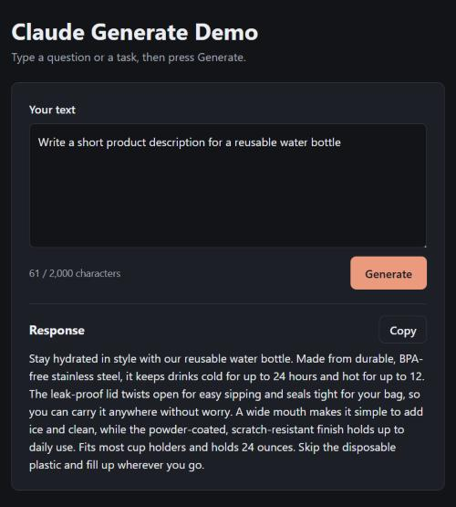

# Claude Generate Demo

A small web app: type some text, press **Generate**, and get an answer from Claude.
Built with Next.js (App Router) and TypeScript, ready to deploy on Vercel.



## Features

- One page with a text box, a **Generate** button and a response area
- Clear loading, success and error states
- Keeps line breaks in the answer, with a **Copy** button
- Mobile-first, accessible layout (labels, visible focus, light and dark mode)

## Safety limits

- The API key is read only on the server (`ANTHROPIC_API_KEY`). It is never sent to the browser.
- Input must be non-empty and at most 2,000 characters.
- Each answer is capped at 800 tokens, and Claude is asked to keep answers to about 150-200 words.
- Rate limit: 10 requests per minute per IP (in memory - see note below).
- Errors from the API are logged on the server; users only see a friendly message.

**Note:** the rate limit lives in memory, so on Vercel it applies per server instance and resets when an instance restarts. It's fine for a demo. For real traffic, use a shared store such as Upstash Redis. Also set a monthly spend limit in the Anthropic Console.

## Run it locally

Requirements: Node.js 20.9 or newer.

```bash
npm install
cp .env.example .env.local
```

Open `.env.local` and paste your API key after `ANTHROPIC_API_KEY=`.
You can create a key at https://platform.claude.com/settings/keys.
`.env.local` is ignored by git, so your key stays out of the repository.

```bash
npm run dev
```

Then open http://localhost:3000.

Other commands:

```bash
npm test          # run the route tests (the Claude API is mocked)
npm run typecheck # check types
npm run build     # production build
```

## Environment variables

| Name | Required | Description |
| --- | --- | --- |
| `ANTHROPIC_API_KEY` | Yes | Your Anthropic API key. Server-side only. |
| `CLAUDE_MODEL` | No | Model to use. Default: `claude-haiku-5-5`. |

## Deploy to Vercel

1. Push this project to a GitHub repository (check that no `.env` file is included).
2. Go to https://vercel.com/new and import the repository. Vercel detects Next.js automatically.
3. Before deploying, open **Environment Variables** and add:
   - `ANTHROPIC_API_KEY` = your key
   - `CLAUDE_MODEL` = `claude-haiku-5-5` (optional)
4. Click **Deploy**.
5. Open the URL Vercel gives you and try a prompt.

If you change an environment variable later, go to **Deployments** and redeploy so the change takes effect.

## Project structure

```
app/
  api/generate/route.ts   Server route that calls Claude
  layout.tsx, page.tsx    Page shell
  globals.css             Styles
components/Generator.tsx  Text box, button, response and copy (client side)
lib/validate.ts           Input validation (shared by client and server)
lib/rateLimit.ts          Simple in-memory rate limiter
tests/generate.test.ts    Route tests with the API mocked
```

## How I built it with AI

I used an AI coding assistant (Claude Code / Codex) to generate the initial structure: the Next.js setup, the page, the API route and the styles. I then reviewed and adjusted the parts that matter most for a public demo:

- **Security:** the API key stays on the server, the model comes from an environment variable, and error details are never shown to users.
- **Validation and limits:** empty and too-long input is rejected, output tokens are capped, and requests are rate limited per IP.
- **Tests:** I checked the tests for input validation, error handling and rate limiting, with the Claude API mocked so no real calls are made.
